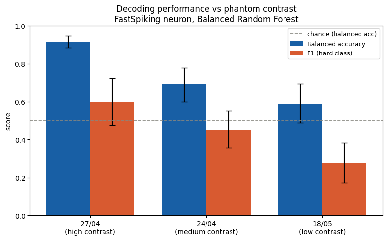
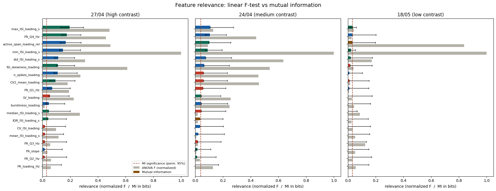
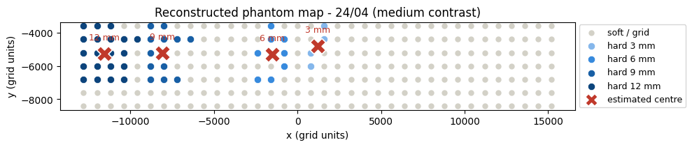

# Neuromorphic Decoding of Hard Inclusions in Soft Materials

From force to spikes to inference: can neuromorphically encoded spike trains reveal the presence, size and position of hard inclusions hidden in a soft material?

Course project for *Neuromorphic Engineering* (MSc in Bionics Engineering, University of Pisa - Scuola Superiore Sant'Anna, A.Y. 2025/26), by Elisa Consoni, Noemi La Gamba and Rosa Vittorione.

## Overview

A force sensor indents agar phantoms point by point on a regular grid (36 x 7 = 252 points). Each phantom hides four spherical inclusions (diameters 12, 9, 6 and 3 mm) that are stiffer than the surrounding matrix. The normal-force signal (Fz) of every indentation is converted into a spike train by bio-inspired neuron models, and the spike trains are then used to decode:

1. **Presence**: is the indented point on a hard inclusion?
2. **Diameter**: how large is the inclusion?
3. **Position**: where is each inclusion centre?

Three phantom acquisitions with different stiffness contrast between inclusion and background are analysed: 27/04 (high, about 8.6), 24/04 (medium, about 1.7) and 18/05 (low, about 1.3).

```
raw force files (LC_*.txt)
        │  matlab/preprocessing_force.m   tare, rectification, 5 Hz low-pass, global [0, 1] normalisation
        ▼
normalised force (Fz, X, Y)
        │  labview/Main.vi                force → input current → Izhikevich neuron → spike sample indices
        ▼
spike-train CSV (one row per indented point) + ground-truth labels
        │  Python notebooks
        ▼
presence ·  feature relevance  ·  Victor–Purpura control  ·  diameter and position
```

## Method

**Signal conditioning (MATLAB).** For each file the first 50 samples are used as a local tare, the force is rectified, and a zero-phase 2nd-order Butterworth low-pass filter (5 Hz cut-off, 1 kHz sampling) is applied. All files of a phantom are then normalised with one shared min-max scale, so relative force differences between points are preserved.

**Spike generation (LabVIEW).** Two nested loops run over the indentation points and, for each, over the Fz samples. The normalised force is mapped to an injection current in the range [3.8, 10] and fed to an Izhikevich neuron whose firing regime is chosen by a selector (regular spiking, fast spiking or chattering). The sample index of every spike is stored. Hundreds of raw force files per phantom are reduced to one spike-train CSV below 1000 KB.

**Ground truth.** The known sphere geometry is aligned with the indentation grid, so each point is labelled hard (inside an inclusion) or soft, and hard points also carry the inclusion diameter.

**Features.** 19 spike-train features are extracted per point: firing-rate and spike-count features (including rate in four sub-windows and rate slope), inter-spike-interval statistics, and regularity measures (CV, CV2, local variation, skewness, burstiness).

**Presence decoding.** SVM, oversampled k-NN and Balanced Random Forest are compared with nested cross-validation. `StratifiedGroupKFold` keeps spatially neighbouring points of the same sphere in the same fold, which prevents spatial leakage. Model selection optimises the hard-class F1, and results are reported as balanced accuracy and hard-class F1 because the hard class is a small minority (46 of 252 points on the 24/04 phantom, 24 on 27/04).

**Victor–Purpura control.** An independent decoder works on the spike timing directly, using the Victor–Purpura distance (minimum cost of turning one spike train into another by adding, deleting or shifting spikes) with k-NN and SVM, to test whether the information is carried by timing or by rate.

**Information analysis.** ANOVA F-score and mutual information are compared as feature-relevance measures, with bootstrap confidence intervals and a label-permutation threshold, followed by an mRMR redundancy analysis.

**Diameter and position.** Hard points are grouped into physical inclusions (DBSCAN on position, within each known diameter). Diameter is inferred both as a 4-class problem (linear SVM) and as regression in millimetres (RBF-kernel SVR), with point-level and leave-one-inclusion-out cross-validation. Each inclusion centre is estimated as the firing-rate-weighted centroid of its hard points.

## Results

### Presence of hard inclusions

Feature-based Balanced Random Forest, fast-spiking neuron, nested cross-validation (mean ± SD over outer folds):

| Phantom | Contrast | Balanced accuracy | F1 (hard class) | Victor–Purpura SVM, balanced accuracy |
|---|---|---|---|---|
| 27/04 | high (about 8.6) | **0.92 ± 0.03** | 0.60 ± 0.12 | 0.78 |
| 24/04 | medium (about 1.7) | 0.69 ± 0.09 | 0.45 ± 0.10 | 0.69 |
| 18/05 | low (about 1.3) | 0.59 ± 0.10 | 0.28 ± 0.10 | 0.48 (chance level) |

<p align="center">
  
</p>

- **Contrast sets the ceiling.** Decoding accuracy follows the stiffness contrast of the phantom, in both the feature-based and the Victor–Purpura decoders, and it matches the information-theoretic analysis: on 27/04 several features carry significant information, while on 18/05 they stay close to the permutation threshold.
- **The information is in the rate, not in the timing.** The feature-based decoder, which captures spike count and firing rate directly, is consistently better than the timing-based Victor–Purpura decoder.
- **High recall, modest precision.** On the high-contrast phantom the hard-class recall is close to 1, but precision is about 0.45, so the hard-class F1 is moderate.

<p align="center">
  
</p>

### Diameter

RBF-kernel SVR on the spike features of the hard points, evaluated in two ways:

| Phantom | Point-level CV: MAE (R²) | Leave-one-inclusion-out: MAE |
|---|---|---|
| 24/04 | 0.99 mm (0.79) | 2.69 mm |
| 27/04 | 2.39 mm (0.08) | 3.26 mm |
| 18/05 | 1.33 mm (0.65) | 3.22 mm |

The two evaluations bracket the truth. The point-level figures are optimistic, because points of the same inclusion fall in both training and test folds. The leave-one-inclusion-out figures are pessimistic: each diameter occurs in exactly one inclusion, so holding an inclusion out removes its diameter from the training set and the model has to extrapolate. The resulting 2.7-3.3 mm is close to the 3.0 mm obtained by always predicting the mean diameter of the four inclusions. With four inclusions per phantom the two cannot be separated, so **diameter inference should be read as exploratory**: the spike trains do not allow us to claim that size generalises to unseen inclusions.

### Position

<p align="center">
  
</p>

The reconstructed map preserves the layout of the phantom: larger inclusions occupy wider footprints and the estimated centres fall inside the corresponding clusters of hard points. Note that this step starts from the labelled hard points and the known diameters (used to separate neighbouring inclusions), so it is not an end-to-end decoder from raw spikes, and the reference centres in the notebook are computed from the same labelled points (the notebook has a hook for the true phantom geometry). The small localisation errors it prints are therefore a consistency check, not an independent accuracy measure.

## Repository structure

```
.
├── matlab/
│   └── preprocessing_force.m                    # filtering and global normalisation of Fz
├── labview/
│   ├── Main.vi                                  # loops over points and samples, writes spike indices
│   ├── Izhikevich_Neuron.vi                     # neuron model
│   └── Neuron_Selector.vi                       # regular / fast spiking / chattering parameters
├── features_presence_decoding.ipynb             # 19 spike features, nested-CV presence classification
├── feature_selection_shannon_information.ipynb  # ANOVA vs. mutual information, mRMR
├── victor_purpura_decoding.ipynb                # timing-based control decoder
├── diameter_position_decoding.ipynb             # diameter regression/classification and centre estimation
├── figures/
└── requirements.txt
```

## Running the code

The experimental recordings and the spike-train CSVs are **not included** in this repository. The notebooks expect the following folders in the repository root (semicolon-separated CSV files):

| Folder | Content | Used by |
|---|---|---|
| `labels_complete/` | `spike_*.csv`: one row per indented point with columns `presence`, `diameter`, `n_samples`, `n_spikes`, `x`, `y`, optionally `contact_start` and `force_peak`, followed by one column per spike (sample index at 1 kHz) | `features_presence_decoding`, `victor_purpura_decoding` |
| `labels_features/` | `spike_features_*.csv`, generated by `features_presence_decoding` | `features_presence_decoding`, `feature_selection_shannon_information` |
| `labeled_datasets/` | labelled spike CSVs for the three phantoms | `diameter_position_decoding` |

1. **Prepare the force data** with `matlab/preprocessing_force.m`: select the folder of `LC_*.txt` files (force in column 4, X and Y in columns 8 and 9) and it writes `Normalized_Force_for_LabVIEW/`.
2. **Generate the spike trains** by running `labview/Main.vi` on the normalised files (the VIs were saved with LabVIEW 25.3.3).
3. **Run the notebooks** from the repository root, in this order: `features_presence_decoding`, `feature_selection_shannon_information`, `victor_purpura_decoding`, `diameter_position_decoding`. `features_presence_decoding` processes one spike CSV at a time: set `input_csv_path` and `output_csv_path` in its first cells for each file.

```bash
pip install -r requirements.txt
```

Developed with Python 3.13.

## Limitations

- Each phantom contains only four inclusions, so diameter and position results rest on very few independent units.
- Only three acquisitions are compared, and contrast is confounded with acquisition session.
- Presence decoding has low precision on the hard class even where recall is high, because hard points are a small minority.

## License

Code released under the [MIT License](LICENSE). The experimental data are not included.
